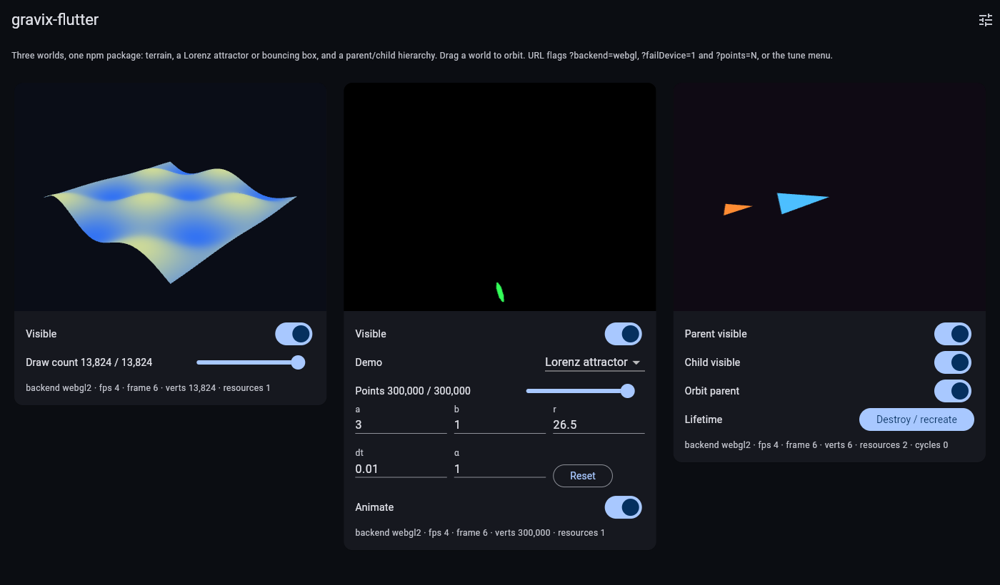
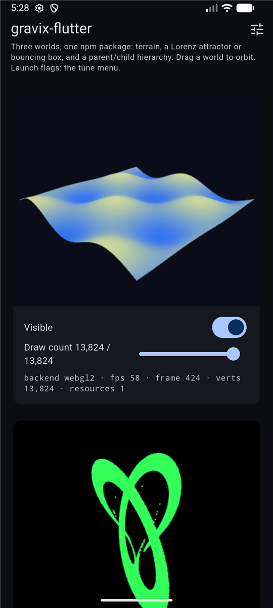

# gravix-flutter

Flutter app for map and point-cloud visualisation, built on
[`@giraphics/gravix-engine`](https://www.npmjs.com/package/@giraphics/gravix-engine)
`0.1.0` from npm. The Flutter sibling of
[gravix-quasar](https://github.com/giraphics/gravix-quasar): the same three
worlds and controls, with a Flutter UI on web, Windows and Android, plus a
fourth world that shows live traffic from
[gravix-sim-backend](https://github.com/giraphics/gravix-sim-backend).

**[Live demo](https://giraphics.github.io/gravix-flutter/)** ·
[WebGL2](https://giraphics.github.io/gravix-flutter/?backend=webgl) ·
[10,000 points](https://giraphics.github.io/gravix-flutter/?points=10000)

GitHub's README cannot run WebGPU, so the demo is that link, not an embedded
canvas. Use a browser with WebGPU (Chrome/Edge). If it is blank, open the
WebGL2 link.



*Captured from a local web build using the WebGL2 backend (`?backend=webgl`).*

Four independent worlds, each its own engine on its own canvas:

| World | Controls |
|---|---|
| **Terrain** (48×48 height field) | Visible · draw count slider |
| **Point cloud** (300,000 points) | Visible · Lorenz attractor / bouncing box · point-count slider · a, b, r, dt, α · Reset · Animate |
| **Hierarchy** (parent + child) | Parent / child visible · orbit parent · destroy / recreate |
| **Traffic** (live simulator run) | Simulator address · scenario · vehicle count · connect / disconnect · pause |

Each card's stats line shows backend, fps, frame, vertices and live resources.

## How it fits together

The engine is JavaScript, so Flutter hosts it rather than reimplementing it:

```
web_src/src/lib/*.ts      gravix-quasar's engine code (geometry, mesh, orbit, Lorenz), unchanged,
                          plus simproto.ts (the simulator's protobuf messages) and traffic.ts
web_src/src/worlds.ts     the four worlds behind window.GravixWorlds
                          mount(kind, host, launch) · state(kind) · invoke(kind, action, args) · dispose(kind)
        │ npm run build (esbuild)
        ▼
assets/www/gravix_worlds.js   one bundle for every platform
assets/www/world.html         hosts one world in a WebView

lib/worlds/world_backend_web.dart     web: HtmlElementView + dart:js_interop, all worlds in one page
lib/worlds/world_backend_native.dart  Windows: WebView2 (webview_windows) · Android: System WebView (webview_flutter)
lib/panels/*.dart                     the four cards, written once against WorldBackend
```

On Windows and Android each world runs in its own WebView, the way Electron
and Capacitor host gravix-quasar. Dart reads each world's state every 250 ms
and sends control changes as `GravixWorlds.invoke(...)` calls.

## Prerequisites

| Tool | Version | For |
|---|---|---|
| Flutter | 3.50 stable | everything |
| Node.js | 22 or newer | building the engine bundle |
| Visual Studio 2022, *Desktop development with C++* | 17.x | Windows |
| Windows **Developer Mode** | on | Windows (Flutter needs symlinks for plugins) |
| Android Studio (SDK, emulator) | current | Android |

## Build scripts

`build.bat` (Windows `cmd`/PowerShell) and `build.sh` (Git Bash, macOS,
Linux, and the GitHub Pages workflow) run the whole chain in order: check
tools, `npm ci` (exactly what `package-lock.json` pins), type-check and bundle
the engine, `flutter pub get`, `flutter analyze`, `flutter test`, then build
the targets you name. They stop at the first failure with a non-zero exit code.

```bat
build.bat                          :: all: web + apk (+ windows if Developer Mode is on)
build.bat web                      :: build\web
build.bat apk                      :: build\app\outputs\flutter-apk\app-release.apk
build.bat windows                  :: build\windows\x64\runner\Release\gravix_flutter.exe
build.bat web --base-href /gravix-flutter/   :: as deployed to GitHub Pages
build.bat apk --debug --skip-checks          :: quick debug build, no analyze/test
build.bat bundle                   :: only assets\www\gravix_worlds.js
build.bat clean                    :: remove every build output
```

```bash
./build.sh web apk                 # same targets and options
```

| Target | Output |
|---|---|
| `web` | `build/web/` (static site) |
| `apk` | `build/app/outputs/flutter-apk/app-<mode>.apk` |
| `windows` | `build/windows/x64/runner/<Mode>/gravix_flutter.exe` (Windows host, Developer Mode on) |
| `all` *(default)* | web + apk, plus windows when it can be built |
| `bundle` | `assets/www/gravix_worlds.js` only |
| `clean` | removes `build/`, `.dart_tool/`, the bundle and Gradle's cache |

| Option | Effect |
|---|---|
| `--debug` | debug builds instead of release |
| `--skip-checks` | skip typecheck, `flutter analyze` and `flutter test` |
| `--base-href PATH` | web base href, e.g. `/gravix-flutter/` |

Two Windows-specific fixes are built in. For `apk`, if `JAVA_TOOL_OPTIONS` is
unset, the scripts point the JDK's socket folder at `build/.jdk-sockets`; this
avoids Gradle's *Unable to establish loopback connection* when the user profile
path contains a space. In Git Bash, `build.sh` stops MSYS from rewriting
`--base-href /x/` into a Windows path.

## Run it

`run.bat` builds the engine bundle, runs `flutter pub get`, then starts the
app on the device you name (default `chrome`):

```bat
run.bat                :: browser
run.bat windows        :: desktop app
run.bat android        :: connected phone or emulator
```

Start the simulator first for the Traffic card:
`..\gravix-sim-backend\run-sim-server.bat`.

## Build the engine bundle by hand

The scripts do this for you. To run it on its own:

```bash
cd C:\dev\giraphics\gravix-flutter\web_src
npm install
npm run build
```

This writes `assets/www/gravix_worlds.js`. It is generated, so it is
gitignored; every platform below needs it. `npm run watch` rebuilds on save
(with source maps); `npm run typecheck` type-checks `src/` against the engine.

## Browser

```bash
cd C:\dev\giraphics\gravix-flutter
flutter run -d chrome
```

Query flags, as in gravix-quasar (before or after the `#`):

| Query | Effect |
|---|---|
| `?backend=webgl` | Force WebGL2 |
| `?failDevice=1` | Fail WebGPU so the WebGL2 fallback is exercised |
| `?points=N` | Point-cloud capacity (default 300000) |

The tune menu in the app bar sets the same flags (and rebuilds the worlds).
After changing `web_src/`, rebuild the bundle and **refresh the tab**: hot
reload only reloads Dart.

## GitHub Pages

Push `main`. The workflow runs `./build.sh web --base-href /gravix-flutter/`
(the same checks as a local build) and deploys `build/web`. **Once**, in the GitHub
repo: **Settings → Pages → Source: GitHub Actions**. After the first green run
the live demo URL above works.

## Desktop (Windows)

> **Not yet verified.** The Windows code path (WebView2 via `webview_windows`)
> is written but has not been built or run; web and Android have.

Turn on **Developer Mode** first (Settings → System → For developers), or the
build stops with *"Building with plugins requires symlink support"*.

```bash
flutter run -d windows
```

Release build:

```bash
flutter build windows --release
```

Run the exe (a folder, not an installer):

```
C:\dev\giraphics\gravix-flutter\build\windows\x64\runner\Release\gravix_flutter.exe
```

Ship the whole `Release` folder. Each world is a WebView2 page served from
`data\flutter_assets\assets\www` under a virtual `https://gravix.assets/` host,
so it is a secure context and can use WebGPU. WebView2 is preinstalled on
Windows 11; on Windows 10 install the Evergreen runtime. The first build
downloads NuGet and the WebView2 SDK.

## Mobile (Android)

App id is **`com.giraphics.gravix_flutter`** (gravix-quasar's Capacitor build
is `com.giraphics.gravix`, so both install side by side). Do not change it
after you ship a store build.

### Do you need a phone?

No. Android Studio and an **emulator** are enough; a USB phone is optional.
Start the emulator with the host GPU for decent frame rates:

```bash
"%LOCALAPPDATA%\Android\Sdk\emulator\emulator.exe" -avd <your AVD> -gpu host
```

**iOS cannot be built on Windows.** It needs a Mac and Xcode, and is not set up
here.

### Run

```bash
flutter devices
flutter run -d emulator-5554
```

There is no dev server to reach: the bundle is packed into the APK as an
asset, so there is no LAN IP to pick and no firewall port to open.

Most Android WebViews do not expose WebGPU yet, so expect `backend webgl2` in
the stats line. The worlds still run at 60 fps on the emulator.

### Release APK

```bash
flutter build apk --release
```

`build\app\outputs\flutter-apk\app-release.apk`, signed with the debug key
until you add a release signing config in `android/app/build.gradle.kts`.



## Traffic world

The fourth card draws a live run of
[gravix-sim-backend](https://github.com/giraphics/gravix-sim-backend): the road
map as lines and every vehicle as a point, coloured by speed. The browser (or
WebView) opens a WebSocket to the Rust simulator and decodes its protobuf
frames in `web_src/src/lib/simproto.ts`. The contract is
`proto/gravix/sim/v1/sim.proto` in the backend repository.

Start the simulator, then press Connect:

```bash
git clone https://github.com/giraphics/gravix-sim-backend
cd gravix-sim-backend/sim
cargo run --release -- serve        # ws://127.0.0.1:8081
```

| Where the app runs | Address to use |
|---|---|
| Web, Windows | `ws://127.0.0.1:8081` (the default) |
| Android emulator | `ws://10.0.2.2:8081` (the default on Android) |
| A phone on your network | `ws://<your computer's address>:8081` |

`?sim=ws://host:8081` in the web address connects the card on load. The
Android debug build allows plain `ws://`; a release build needs `wss://`, so
put the simulator behind TLS before using it from a release APK. The page
that hosts the app over HTTPS also needs `wss://` (browsers block `ws://` from
an HTTPS page, except for `localhost`).

The stats line shows the stream rate, the tick, the vehicle count and the
latency. Latency is the simulator's send time against this device's clock, so
it is only meaningful when both run on the same machine.

## Tests

```bash
flutter analyze
flutter test
cd web_src && npm run test          # the protobuf decoder
```

The widget tests run the real panels against a fake `WorldBackend`, so they
need no browser or WebView: state in, actions out, and a launch-flag change
rebuilding every world. The decoder tests build frames by hand and check they
read back, including unknown fields and truncated input.

## Troubleshooting

| Symptom | Cause |
|---|---|
| Stats line says `starting…` forever, or a card stays black | `assets/www/gravix_worlds.js` missing: run `npm run build` in `web_src/` |
| *Building with plugins requires symlink support* | Windows Developer Mode is off |
| `error: …` in a stats line | The engine failed to start in that world; try the WebGL2 flag |
| Android build fails with *Unable to establish loopback connection* | JDK socket temp dir problem when the user profile path has a space. `build.bat` / `build.sh` handle it; for a bare `flutter build apk`, set `JAVA_TOOL_OPTIONS=-Djdk.net.unixdomain.tmpdir=C:/tmp` (any short path without spaces) |
| `--base-href should start and end with /` from `build.sh` in Git Bash, showing `C:/Program Files/Git/...` | MSYS path conversion; `build.sh` disables it for that call. Run Flutter directly with `MSYS_NO_PATHCONV=1` |
| A world draws into a strip or not at all in a WebView | Its host collapsed to 0 px; `logcat` / WebView2 DevTools show `[gravix] … canvas WxH` lines for each resize |

## What not to commit

| Keep out of git | Why |
|---|---|
| `assets/www/gravix_worlds.js` | Built from `web_src/` |
| `web_src/node_modules/` | npm install |
| `build/` | Flutter output (web, Windows, Android) |
| `.dart_tool/` | Flutter tool cache |

Commit `web_src/` (with `package-lock.json`), `lib/`, `assets/www/world.html`,
`android/`, `windows/`, `web/` and `test/`.

## License

MIT
